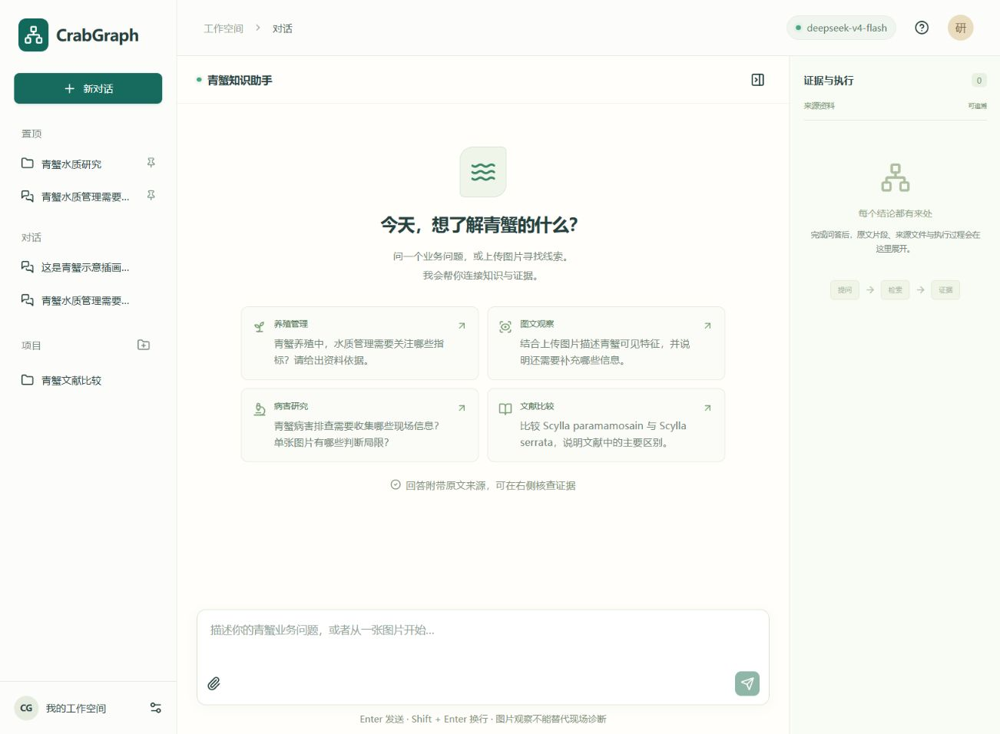
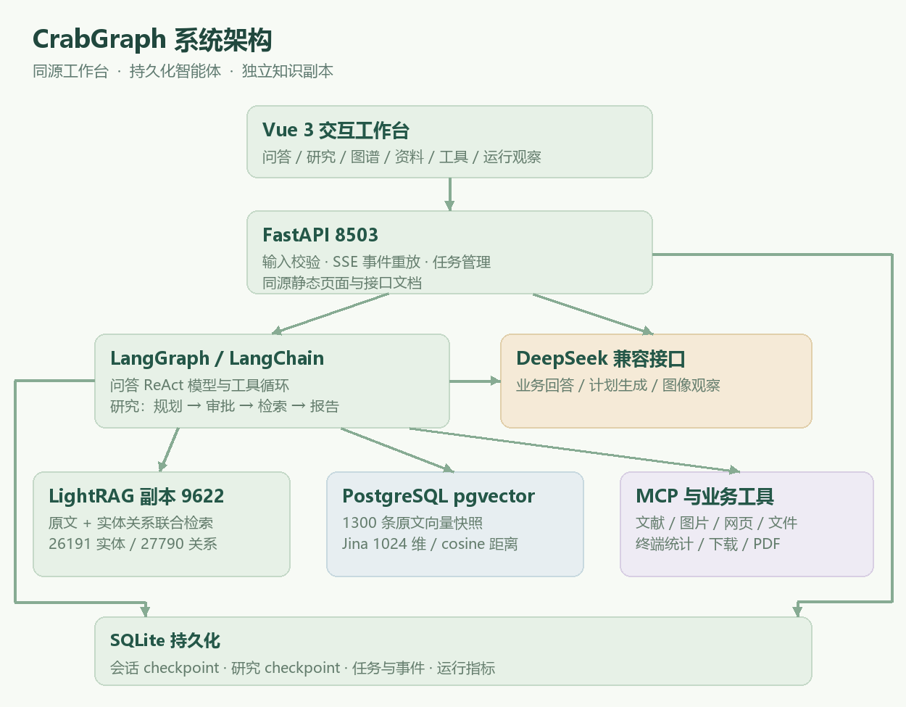
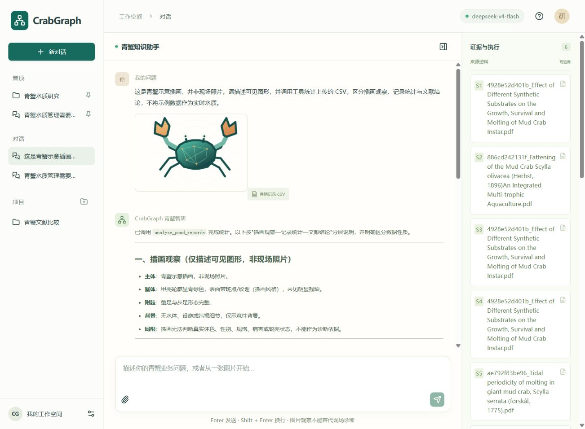
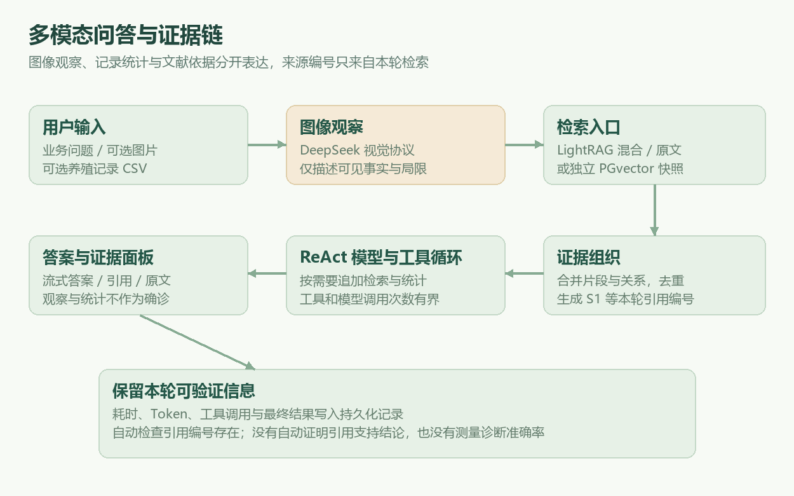
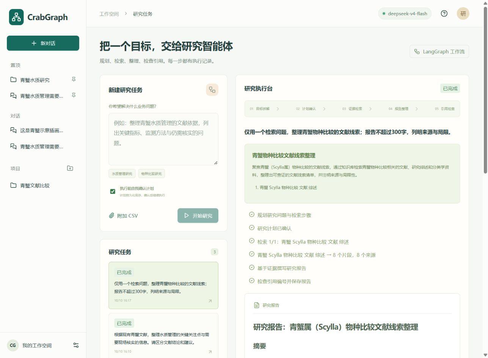
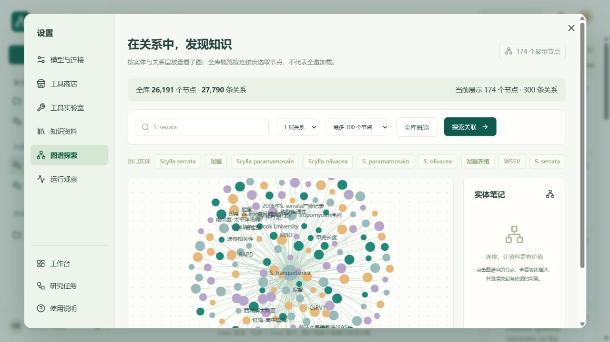
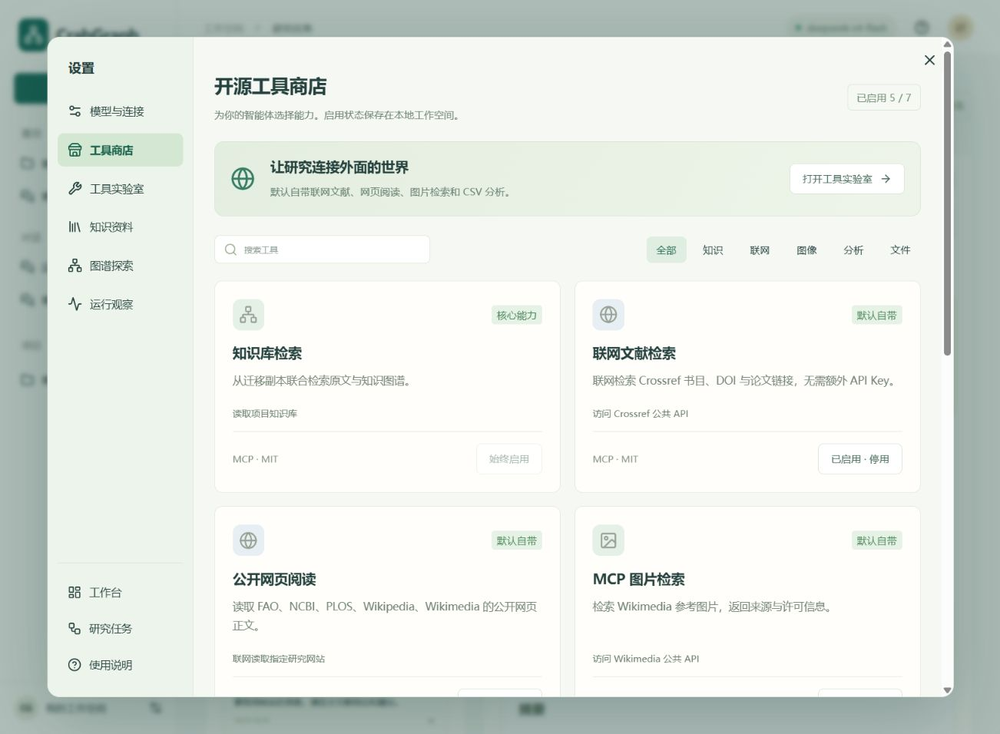
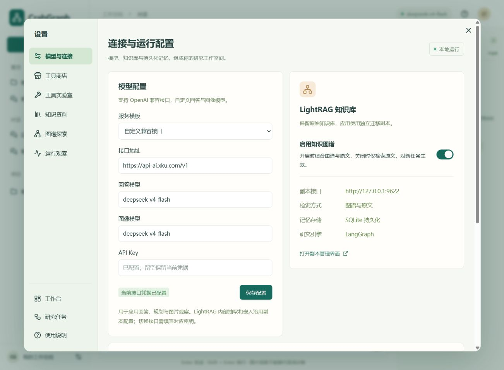

# CrabGraph 青蟹智研工作台

基于 **FastAPI + LangGraph + Vue 3 + LightRAG** 的青蟹知识问答与研究智能体，支持图片观察、知识检索、工具调用和研究报告。



## 主要功能

- **知识问答**：多轮对话、图片与 CSV 输入、流式回答，附来源引用和原文证据。
- **研究任务**：生成研究计划，人工确认后执行检索并导出报告。
- **知识与图谱**：管理资料、探索实体关系，分别显示全库统计和当前子图数量。
- **工具商店**：内置 7 个工具，默认启用知识检索、联网文献、网页阅读、MCP 图片检索和 CSV 分析；PDF 下载与笔记保存按需开启。
- **工作空间**：对话与项目分组、置顶；头像设置弹窗集中管理模型、工具和知识库。

## 技术栈

| 层次 | 技术 |
|---|---|
| 前端 | Vue 3、TypeScript、ECharts |
| 后端 | FastAPI、SSE |
| 智能体 | LangChain、LangGraph、MCP |
| 知识检索 | LightRAG、pgvector（本机通过 PGlite 运行） |
| 状态存储 | SQLite、LangGraph Checkpointer |
| 模型 | DeepSeek；支持通义千问、智谱及自定义 OpenAI 兼容接口 |

## 系统架构



Vue 工作台通过 FastAPI 提交问答、研究和工具任务，后台线程执行模型与检索调用，SSE 将执行阶段、回答文本和最终结果推送到页面。LightRAG 负责图谱与原文检索，模型负责规划、工具选择和答案生成，SQLite 保存会话、任务及工作流状态。

项目包含两条智能体流程：**普通问答采用模型与工具循环，研究任务采用可审批的固定工作流**。两者复用模型配置、证据组织和知识检索能力。

## 重要模块设计

### 1. 多模态问答与工具调用



问答流程为：`问题 / 图片 / CSV → 图片观察（可选）→ 知识检索 → 模型与工具循环 → 引用检查 → 回答与证据`。

图片先由视觉模型生成观察描述，再与用户问题共同参与知识检索；CSV 交给固定统计程序处理，返回最小值、最大值、均值和首末变化等描述统计。答案区分图片观察、用户记录和文献结论，避免把示例数据当成实时养殖状态。

模型可按需补充检索或调用已启用工具。会话使用 `session_id` 作为 LangGraph 的 `thread_id` 保存上下文；工具异常转成可反馈的信息，工具循环设有递归上限。前端分别展示流式文本、工具调用阶段和完成后的回答。

实现：[agent.py](src/crabgraph/agent.py)、[multimodal.py](src/crabgraph/multimodal.py)、[pond.py](src/crabgraph/pond.py)。

### 2. 知识检索与证据溯源



对话区不显示检索模式下拉框，用户在设置中选择是否启用知识图谱：**开启使用图谱与原文混合检索，关闭仅检索原文**。偏好保存在 SQLite，问答与研究提交时保存设置快照；关闭后，即使模型的补充检索工具请求图谱模式，也会使用原文检索。MCP 知识检索调用遵循当前工作空间设置。

通过 LightRAG 的 `/query/data` 获取原文片段、实体、关系和来源引用。底层保留 `mix / hybrid / local / global / naive` 模式及独立的 `pgvector` 快照接口，便于开发调试；日常操作只需知识图谱开关。图谱检索没有返回原文时，补充 `naive` 原文检索。

证据层合并检索结果、去重片段，并分配 `[S1]`、`[S2]` 等来源编号。生成时提供原文与图谱上下文，完成后检查引用编号是否存在；用户点击引用即可在右侧核查原文。知识资料模块负责上传和管理文件，证据面板展示本轮实际检索结果。

引用检查验证的是来源编号有效性，语义支持关系仍需结合原文判断。问答与研究分别保存执行轨迹，切换历史对话时按对应运行记录恢复证据，避免串入其他任务的来源。

实现：[retrieval.py](src/crabgraph/retrieval.py)、[pgvector.py](src/crabgraph/pgvector.py)。

### 3. 研究计划、人工确认与报告



研究流程为：`plan → approval → research → compose → verify`。

规划节点用结构化输出将研究目标拆成最多 3 个检索问题；确认节点通过 LangGraph `interrupt` 暂停执行。用户确认后使用 `Command(resume=True)` 从检查点恢复，依次检索知识库、分析附加 CSV、生成报告并检查引用编号。关闭页面后，待确认的计划仍保存在本地。

报告包含研究发现、来源证据与局限，可导出 Markdown 或 PDF。普通问答允许模型自主选择已启用工具；研究流程按已确认计划执行知识库检索，使研究范围和步骤便于查看。

实现：[workflow.py](src/crabgraph/workflow.py)、[reports.py](src/crabgraph/reports.py)。

### 4. LightRAG 迁移隔离与图谱探索



项目使用 `runtime/lightrag` 内的独立副本，服务端口为 `9622`；原始 `9621` 实例及原目录独立管理。启动、停止脚本检查进程和目录归属，迁移记录通过文件哈希核对数据一致性，沿用原有嵌入模型与向量维度。

图谱页面将**全库数量**与**当前展示子图**分开标注。本机迁移前后均为 **26,191 个节点、27,790 条关系**；页面按中心实体、1–3 层关系和 65–1,000 个节点上限探索，默认上限为 300。全库概览按连接度选取节点，达到上限时提示截断，避免将展示数量误认为知识库总量。

PGvector 使用副本中的 1,300 条 1,024 维原文向量快照，本机通过 PGlite 运行 PostgreSQL 与 pgvector。新增资料进入 LightRAG，当前不会自动同步该快照。

实现：[graph_stats.py](src/crabgraph/graph_stats.py)、[启动脚本](start.ps1)、[维护文档](docs/operations.md)。

### 5. 开源工具商店与 MCP



工具目录统一记录名称、分类、默认状态、操作范围及 Agent / MCP 工具名称。用户在商店选择启停，偏好写入 SQLite；知识检索作为核心能力始终启用。

| 工具 | 默认状态 | 用途 |
|---|---|---|
| 知识库检索 | 启用，核心能力 | 检索青蟹原文与图谱 |
| 联网文献检索 | 启用 | 获取 Crossref 书目、DOI 和论文链接 |
| 公开网页阅读 | 启用 | 读取指定研究网站正文 |
| MCP 图片检索 | 启用 | 获取 Wikimedia 参考图片、来源与许可 |
| 养殖记录分析 | 启用 | 运行固定 Python CSV 统计程序 |
| 研究 PDF 下载 | 按需启用 | 保存公开 PDF 到项目资源目录 |
| 研究笔记 | 按需启用 | 保存 Markdown 笔记 |

问答提交时保存启用工具快照，并据此筛选模型可调用的工具；工具实验室在提交时检查开关，MCP 在每次调用时检查最新状态。网页阅读与下载限定研究站点，CSV 分析使用固定程序，文件输出保存在项目目录。

MCP 服务使用标准 `stdio` 协议，将上述 7 个工具提供给支持 MCP 的其他客户端；应用内图片检索也经过真实 MCP 客户端调用。当前商店提供本项目的开源适配器与外部源码参考入口，尚未实现任意第三方 MCP 服务器的一键安装。

实现：[tool_registry.py](src/crabgraph/tool_registry.py)、[business_tools.py](src/crabgraph/business_tools.py)、[mcp_server.py](src/crabgraph/mcp_server.py)。

### 6. 后台任务、事件流与持久化

FastAPI 创建任务后交给后台线程池，任务状态经过 `queued / running / awaiting_approval / completed / failed / cancelled`。SSE 事件写入数据库后推送，支持按事件编号重放；浏览器断开不取消后台任务。

| 数据 | 存储 | 作用 |
|---|---|---|
| 会话、消息、项目、任务、事件与工具及检索偏好 | `workbench.sqlite` | 页面展示、任务查询、事件重放 |
| 问答智能体状态 | `conversations.sqlite` | 保留模型与工具消息上下文 |
| 研究工作流检查点 | `research-checkpoints.sqlite` | 保存计划与审批暂停状态 |
| 问答性能记录 | `metrics.sqlite` | 记录耗时、Token 和工具调用 |

每个会话只允许一个进行中的问答，后台最多 2 个执行线程，提交时对排队和执行中的任务总数设置 4 个的上限。取消采用协作式检查，网络调用返回后停止后续步骤。服务重启会将未完成的执行任务标为失败，待审批计划保留并可继续确认。

实现：[api.py](src/crabgraph/api.py)、[store.py](src/crabgraph/store.py)。

### 7. 工作空间界面与模型配置



主侧栏仅保留普通对话、置顶项目或对话、普通项目。对话输入区保留输入、附件与发送，移除检索模式和项目归属下拉框；项目内可创建对话。项目归属、置顶与工具及知识图谱偏好持久化保存；模型、工具、资料、图谱及运行观察集中在头像设置弹窗中。弹窗支持分类切换、独立滚动和 Esc 关闭，关闭后保留当前对话、证据与未发送草稿。

模型配置预置 DeepSeek、通义千问和智谱模板，也支持自定义 OpenAI 兼容接口，分别设置回答模型和图像模型。配置接口仅返回凭据是否存在，保存时原子更新项目 `.env`；更换接口需提供对应密钥，已有排队或执行任务时拒绝修改。配置用于后续应用回答、规划与图片观察，LightRAG 内部抽取和嵌入沿用副本配置。

前端采用 Vue 3 与 TypeScript，Markdown 经 DOMPurify 清理，ECharts 按需加载；移动端折叠侧栏与设置分类，证据面板按需展开。

实现：[App.vue](frontend/src/App.vue)、[model_config.py](src/crabgraph/model_config.py)。

## 快速启动

需要 Windows PowerShell、Git、uv、Python 3.13 和 Node.js 22+。本仓库发布应用源码与说明截图，私有知识资料、LightRAG 副本、运行数据库与模型凭据需在本机准备。

首次从 GitHub 安装：

```powershell
git clone https://github.com/CyuYing/CrabGraph.git E:\Projects\CrabGraph
cd E:\Projects\CrabGraph

# 原 LightRAG 服务保持运行且导入任务空闲；替换为自己的源码目录。
uv run --no-project --python 3.13 python scripts/migrate_lightrag.py --source "D:\LightRAG-source" --url http://127.0.0.1:9621
.\setup.ps1
```

迁移脚本只读取原目录，将源码、知识库和配置复制到项目内并校验哈希；目标副本已存在时拒绝覆盖。沿用原库的嵌入模型与向量维度，在 `runtime/lightrag/.env` 核对副本凭据。接着在根目录 `.env` 填写回答模型配置，图片功能还需配置支持图像输入的模型。两个配置文件都被 Git 忽略。

已安装或本机现有版本使用 PowerShell 启动：

```powershell
cd E:\Projects\deepseek-lightrag-agent
.\start.ps1
```

- [工作台](http://127.0.0.1:8503)
- [接口文档](http://127.0.0.1:8503/docs)
- [LightRAG 副本管理](http://127.0.0.1:9622/webui/)

停止服务使用 `stop.ps1`。上述脚本管理项目副本与应用进程，原 LightRAG 实例独立运行。无现有知识库时需先建立自己的 LightRAG，再按上述流程复制；截图中的青蟹私有文献不随仓库分发。

点击头像 → **模型与连接**，选择模板或填写接口地址、模型名称和 API Key。保存后用于后续应用任务。

## 演示流程

1. 提问青蟹养殖问题，点击回答中的引用，核查原文。
2. 上传图片或 CSV，查看图片观察与统计工具结果。
3. 在设置中打开研究任务，确认计划并导出报告；也可体验图谱探索和工具商店。

## 开发与文档

```powershell
.\.venv\Scripts\pytest.exe -q
.\.venv\Scripts\ruff.exe check src scripts tests --config pyproject.toml
npm --prefix frontend run build
```

已通过 25 项自动化测试、Ruff 检查和前端生产构建，覆盖会话互斥、审批恢复、迁移隔离、工具启停、项目置顶、模型配置，以及知识图谱关闭后的原文检索和任务设置快照。真实运行已验证知识问答、图片与 CSV 工具调用、研究报告导出和 MCP 协议；图片与 CSV 验收使用示意插画和合成记录，未测量现场图像识别准确率。

本页截图来自本机实际运行界面，架构与检索图沿用带图说明书。问答截图中的插画和 CSV 为功能验收样例。

当前为本机工作台，Serverless 已提供入口适配及事件测试，尚未完成云端部署。详细结果见 [验收记录](docs/validation.md)。

- [带图项目说明](docs/project-guide.html)：架构、业务流程、界面与面试演示。
- [运行维护](docs/operations.md)：配置、启动、备份与 MCP 接入。
- [GitHub 调研](research/github_report.md)：参考项目与来源。
- [技术覆盖对照](docs/technology-coverage.json)：参考飞书项目的 16 项选型，按 Python 等价能力覆盖 13 项（81.25%）。

工作台代码采用 [MIT](LICENSE) 许可；第三方组件保留各自许可，私有知识资料与凭据不随源码分发。
